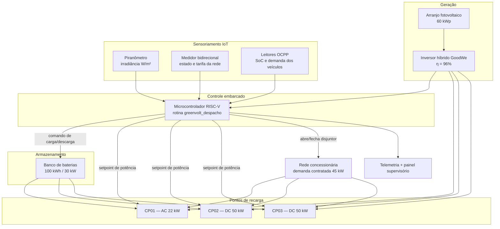
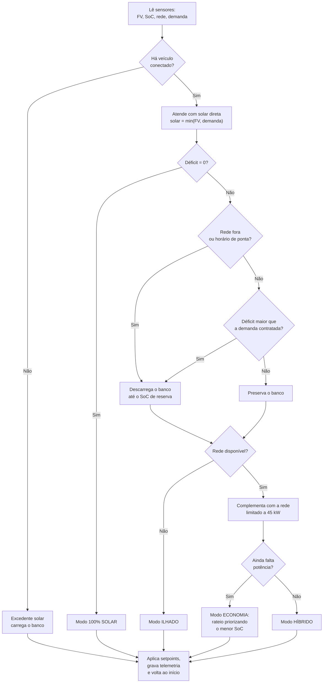

# GreenVolt — Solução Integrada de Gerenciamento Energético para Eletropostos Sustentáveis

**Sprint 4 — Solução Final Integrada e Inovadora (Desafio GoodWe)**

## Equipe

| Integrante                 | RM       |
|----------------------------|----------|
| João Victor Canello Ferian | RM573295 |
| Gustavo Melo dos Santos    | RM573562 |
| João Pedro Costenari Silva | RM572260 |
| Lucas Klein                | RM570029 |

**Vídeo técnico da Sprint 4:** `[COLAR AQUI O LINK DO VÍDEO]`

**Histórico do projeto:**
[Sprint 1 — proposta](https://github.com/Melirous/1CCPO-Equipe2-S1-SERS) ·
[Sprint 2 — arquitetura](https://github.com/Melirous/1CCPO-Equipe02-S2-SERS) ·
[Sprint 3 — protótipo funcional](https://github.com/Melirous/1CCPO-Equipe02-S3-SERS) ·
[vídeo da Sprint 3](https://youtu.be/bzoh9Re_jHI)

---

## 1. Resumo da solução

O GreenVolt é um eletroposto que **prioriza energia solar**, armazena o excedente em baterias e só recorre à rede da concessionária quando necessário. Um controlador toma uma decisão por minuto sobre de onde vem cada kW entregue aos veículos, protege a bateria, respeita a demanda contratada e continua recarregando quando a rede cai.

Esta Sprint consolida as três anteriores em uma entrega única: proposta (S1), arquitetura com microcontrolador RISC-V (S2) e planta simulada operando 24 horas com dados reais de execução (S3). Todos os números deste documento saem de arquivos versionados em `dados/` e podem ser reproduzidos com três comandos (seção 11).

> **Transparência:** a planta (sensores, veículos, rede, inversor) é **simulada** em Python, com semente fixa. Nada foi medido em hardware real. Onde a solução não implementa algo exigido no desafio, isso está dito explicitamente (seções 5 e 9).

---

## 2. Arquitetura final e integração dos sistemas

### 2.1 Diagrama de blocos


<details><summary>Versão em Mermaid (texto)</summary>



</details>

### 2.2 Ciclo de decisão (uma vez por minuto)


<details><summary>Versão em Mermaid (texto)</summary>



</details>

### 2.3 Como os arquivos se conectam

```
sensores.py  ──(leituras)──▶  controlador.py  ──(setpoints)──▶  simulador.py
                                    │                                │
                         firmware/decisao_riscv.s              dados/*.csv, *.json
                         (mesma lógica, embarcada)                   │
                                                                     ├──▶ dashboard.py ──▶ docs/dashboard.html + docs/*.png
                                                                     └──▶ (leitura independente) prototipo/prototipo_interativo.html
```

- `sensores.py` produz irradiância, tarifa, estado da rede e chegada de veículos.
- `controlador.py` decide a origem de cada kW e o rateio entre os pontos.
- `simulador.py` é o laço de tempo (passo de 1 min, 1.440 passos) que liga tudo e grava a telemetria.
- `dashboard.py` só consome o que foi gravado: nenhum número do painel é digitado à mão.
- `prototipo/prototipo_interativo.html` reimplementa o ciclo no navegador, com controles deslizantes para dimensionamento (potência FV, capacidade e potência do banco, demanda contratada, fluxo de veículos, semente), para explorar cenários sem instalar nada.

---

## 3. Alinhamento ao desafio GoodWe

| Aspecto do desafio | Como a solução responde | Onde ver |
|---|---|---|
| Geração, armazenamento e uso de energia renovável | Arranjo de 60 kWp, banco de 100 kWh / 30 kW e despacho com prioridade solar → banco → rede | `src/controlador.py` |
| Inversor híbrido como núcleo da planta | O inversor híbrido GoodWe (η = 96%) é o ponto que concentra FV, bateria e rede, o que evita um estágio extra de conversão. O rendimento está parametrizado na geração simulada | `src/sensores.py` (`EFICIENCIA_INVERSOR`) |
| Monitoramento inteligente | Telemetria por minuto (17 campos), log de comandos automáticos e painel supervisório | `dados/`, `docs/dashboard.html` |
| Continuidade de serviço | Em queda de rede, o sistema abre o disjuntor, opera ilhado pelo banco e rebaixa a reserva de SoC de 20% para 10%; a sessão em curso não é interrompida | `dados/eventos_automacao.csv` (13:05) |
| Gestão de custo e demanda | Rede nunca acima dos 45 kW contratados; banco usado na ponta para evitar a tarifa mais cara | `src/teste_integracao.py` |

**Limite desta entrega quanto à GoodWe:** a compatibilidade com o equipamento é de **modelagem**. O código não se comunica com um inversor GoodWe real nem com a plataforma de monitoramento do fabricante. O caminho previsto é substituir `sensores.py` por leituras do inversor (por protocolo industrial ou API do fabricante), mantendo o controlador intacto, porque a interface entre as camadas já foi desenhada para isso. Os protocolos e registradores exatos dependem do **modelo escolhido** e devem ser confirmados na documentação oficial da GoodWe antes de qualquer implementação.

### Por que cada tecnologia foi escolhida

| Componente | Escolha | Justificativa |
|---|---|---|
| Geração | Arranjo de 60 kWp | Dimensionado para o perfil diurno da planta simulada, sem superdimensionar o investimento. O pico de geração do dia simulado foi de 51,15 kW |
| Inversor | Híbrido GoodWe (η 96%) | Gerencia FV, baterias e rede no mesmo equipamento, eliminando um estágio de conversão e a perda associada |
| Armazenamento | 100 kWh / 30 kW | Absorve o excedente do meio-dia e sustenta a ponta (18h–21h). O limite de 30 kW explica por que 26,9 kWh ainda vieram da rede na ponta |
| Controle | Microcontrolador RISC-V | ISA aberta, sem royalties, rotina em aritmética inteira de 32 bits sem FPU: o sistema que gerencia a energia consome pouca energia |
| Lógica embarcada | Assembly RV32IM | Tempo de execução determinístico, requisito de um laço que atua sobre potência |
| Protótipo | Simulação em Python com semente fixa | Reproduz 24 h em segundos e é auditável e repetível |
| Comunicação com os pontos | OCPP (modelado) | Protocolo aberto do setor; permite comandar o setpoint de cada ponto, base do modo economia |

---

## 4. Alinhamento à disciplina

| Conteúdo | Onde aparece |
|---|---|
| Arquitetura de computadores e ISA RISC-V | `firmware/decisao_riscv.s`: rotina `greenvolt_despacho` em RV32IM, com convenção de chamada (argumentos em `a0`–`a5`, `s0`–`s3` salvos na pilha) |
| Programação em Assembly | Desvios condicionais (`blt`, `ble`, `beqz`), acesso à memória (`lw`/`sw`) e cálculo de endereço por deslocamento (`slli` + `add`) no laço `rateia_potencia` |
| Representação de dados e aritmética inteira | Potência em watts e SoC em por mil, para eliminar ponto flutuante do laço de controle |
| Sistemas embarcados e tempo real | Laço determinístico, amostragem periódica e saída por estrutura em memória |
| Sensores e IoT | `src/sensores.py`: piranômetro, medidor bidirecional e leitores OCPP como fontes de telemetria |
| Lógica de programação e estruturas de dados | Máquina de decisão, fila de veículos e rateio ordenado por prioridade em `src/controlador.py` |
| Energias renováveis e sustentabilidade | Curva FV com variação de nebulosidade, priorização de fonte renovável, cálculo de CO₂ evitado |
| Análise de dados | Consolidação da telemetria em indicadores e gráficos (`src/dashboard.py`) |

---

## 5. Diferenciais inovadores — o que existe e o que não existe

| Diferencial pedido | Status | Evidência / observação |
|---|---|---|
| Algoritmo inteligente de despacho | **Implementado** (baseado em regras) | Prioridade em quatro níveis, uso seletivo do banco, rateio pelo menor SoC. É um algoritmo heurístico determinístico, **não** aprendizado de máquina |
| Automação avançada | **Implementado** | 22 transições de modo em 24 h sem operador, incluindo ilhamento automático |
| Interface amigável e visualização de dados | **Implementado** | Painel `docs/dashboard.html`, três gráficos em `docs/` e protótipo interativo com controles deslizantes |
| Validação automatizada | **Implementado** | 8 verificações em `src/teste_integracao.py`, todas aprovadas |
| Previsão de geração ou de demanda | **Não implementado** | O controlador reage ao instante presente; não antecipa nuvens nem chegadas |
| Integração com assistentes virtuais | **Não implementado** | Não há módulo de voz ou chat no repositório |
| Execução em hardware (RISC-V, ESP32, inversor real) | **Não implementado** | O Assembly foi escrito para montar com `riscv32-unknown-elf-as`, mas não foi executado em placa |

---

## 6. Resultados

Todos os valores abaixo vêm de `dados/resumo_diario.json` e `dados/telemetria_24h.csv`: ciclo de 24 horas, semente 42, passo de 1 minuto.

### 6.1 Indicadores quantitativos

| Indicador | Valor |
|---|---|
| Energia entregue aos veículos | **459,83 kWh** |
| — fotovoltaica direta | 248,01 kWh |
| — banco de baterias | 89,79 kWh |
| — rede concessionária | 122,04 kWh |
| Participação renovável (critério do projeto) | **73,5%** |
| Geração fotovoltaica total | 365,74 kWh |
| Excedente armazenado no banco | 60,61 kWh |
| Excedente não aproveitado (banco cheio) | 57,11 kWh |
| Sessões de recarga concluídas | 16 |
| Energia média por sessão | 28,57 kWh |
| Duração média por sessão | 120 min |
| Custo com o GreenVolt | R$ 104,98 |
| Custo se toda a energia viesse da rede | R$ 394,41 |
| **Economia no dia** | **R$ 289,43 (73,4%)** |
| CO₂ evitado | 13,01 kg |
| Minutos sem consumir da rede | 521 |
| Minutos em modo economia / ilhado | 46 / 30 |
| Potência máxima da rede | 45,0 kW (= demanda contratada) |
| Demanda máxima instantânea dos veículos | 107,0 kW |
| Energia da bateria usada na ponta (18h–21h) | 70,9 kWh |
| Energia da rede ainda usada na ponta | 26,9 kWh |

### 6.2 Gráficos reais da execução

**Despacho por fonte ao longo do dia.** A faixa em que a rede desaparece, às 13h05, é a interrupção de rede: o banco assume sozinho e nenhuma sessão é interrompida.


**Estado de carga do banco e excedente.** O banco enche com o sol do meio-dia, sustenta o ilhamento e a ponta e termina o dia em 22,2%, logo acima da reserva técnica.


**Composição da energia entregue.**


### 6.3 Resultados qualitativos

- **Continuidade em falha:** a sessão do CP03 iniciada às 13h01 atravessou a queda de rede das 13h05 e terminou normalmente às 14h18.
- **Previsibilidade:** a mesma semente gera exatamente os mesmos arquivos, o que torna a demonstração auditável.
- **Operação sem intervenção:** o log de comandos (`dados/eventos_automacao.csv`) registra cada reconfiguração com hora, modo, ação, geração FV e SoC.
- **Exploração de cenários:** o protótipo interativo permite variar o dimensionamento e ver o efeito nos indicadores.

### 6.4 Validação das regras

```
[OK] Sol cobre toda a demanda -> nao aciona a rede
[OK] Sol insuficiente fora de ponta -> complementa com a rede
[OK] Horario de ponta -> bateria assume o complemento
[OK] Queda de rede -> opera ilhado pelo banco
[OK] Demanda acima do contrato e banco na reserva -> modo economia
[OK] Sem veiculos -> excedente solar carrega o banco
[OK] Rede nunca ultrapassa a demanda contratada (45.0 kW <= 45.0 kW)
[OK] Balanco de potencia fecha (rateio 49.00 kW = entregue 49.00 kW)
8/8 verificacoes aprovadas
```

---

## 7. Avaliação crítica de sustentabilidade e inovação

**O que os dados sustentam.** O despacho por prioridade reduziu o custo simulado em 73,4% e manteve a rede sempre dentro dos 45 kW contratados, mesmo com demanda instantânea de até 107 kW. O banco deslocou 70,9 kWh de consumo da ponta, que é a faixa de maior tarifa.

**A participação renovável de 73,5% está levemente superestimada.** O indicador conta toda a descarga do banco como renovável, mas o banco começou o dia com 55% de carga (55 kWh) de origem não rastreada. Pela telemetria, o banco absorveu 60,61 kWh de excedente solar, dos quais ≈ 56,97 kWh ficaram armazenados após a eficiência de carga de 94%. Os outros ≈ 32,8 kWh entregues pelo banco vieram da carga inicial, e o SoC terminou em 22,2%. Com critério conservador (apenas sol gerado no próprio dia):

> (248,01 + 56,97) ÷ 459,83 ≈ **66,3%** (cálculo da equipe a partir dos valores de `resumo_diario.json`)

Os dois números devem ser apresentados juntos. Além disso, o dia simulado **não é neutro em energia**: repetido por vários dias seguidos, o banco partiria cada vez mais baixo.

**O ganho de carbono é modesto, e isso é esperado.** O fator adotado para a rede brasileira (0,0385 kgCO₂/kWh, parametrizado em `src/simulador.py`) é baixo porque a matriz já é majoritariamente renovável. Os 13,01 kg evitados não são o argumento principal do projeto. O ganho forte é **econômico e de alívio da rede**: o eletroposto consome da concessionária no máximo 45 kW enquanto atende até 107 kW.

**Limites econômicos.** A economia de R$ 289,43 compara com o cenário "toda a energia da rede" usando tarifas simuladas (R$ 0,75 fora de ponta e R$ 1,25 na ponta). Não inclui investimento, manutenção nem retorno financeiro, portanto não permite afirmar tempo de retorno.

**O que a inovação entrega e o que não entrega.** A inovação real está na combinação de despacho por prioridade, ilhamento automático, rateio pelo menor SoC e controlador em Assembly RISC-V sem ponto flutuante. Não há previsão, aprendizado de máquina nem assistente virtual (seção 5).

**Desperdício solar.** 57,11 kWh foram perdidos entre 10h37 e 17h29 com o banco cheio. É a justificativa quantitativa para ampliar o armazenamento ou habilitar injeção na rede.

---

## 8. Referências e conexões técnicas

| Categoria | Item | Uso no projeto |
|---|---|---|
| Linguagens | Python 3.10+ | Sensores, controlador, simulador, dashboard e testes |
| Linguagens | Assembly RISC-V (RV32IM) | Rotina de despacho embarcada |
| Linguagens | HTML, CSS e JavaScript | Painel supervisório e protótipo interativo |
| Bibliotecas | Biblioteca padrão do Python | Simulador e testes |
| Bibliotecas | `matplotlib` | Gráficos do painel |
| Ferramentas | `riscv32-unknown-elf-as` | Montagem do firmware |
| Ferramentas | Git e GitHub | Versionamento e entrega |
| Equipamento | Inversor híbrido GoodWe | Modelado (η = 96%); não integrado a hardware real |
| Protocolo | OCPP | Comando dos pontos de recarga (modelado) |
| Sensores | Piranômetro, medidor bidirecional, leitores dos carregadores | Representados em `src/sensores.py` |
| Dados | Fator de emissão do SIN | 0,0385 kgCO₂/kWh, adotado no projeto e parametrizável |

---

## 9. Limitações e próximos passos

- **57,11 kWh de sol perdidos** com o banco cheio: ampliar o armazenamento ou habilitar injeção na rede.
- **46 minutos em modo economia** no pico do fim da tarde: reserva de horário reduziria a concorrência pelos pontos.
- **Sem previsão:** um previsor de irradiância e de chegadas permitiria carregar o banco antes de nuvens e preparar a ponta.
- **Sem assistente virtual:** uma camada de consulta (por voz ou chat) sobre `dados/` e o painel seria o passo natural.
- **Hardware real:** substituir `sensores.py` por leituras de um ESP32 com sensor de corrente, piranômetro e do inversor GoodWe, mantendo o controlador.
- **Assembly em placa:** a validação atual é a equivalência lógica com o controlador em Python.

---

## 10. Estrutura do repositório

```
.
├── README.md
├── roteiro_video.md              # roteiro do vídeo técnico de 5 min
├── src/
│   ├── sensores.py               # camada de sensoriamento IoT
│   ├── controlador.py            # máquina de decisão e banco de baterias
│   ├── simulador.py              # laço de operação de 24 h
│   ├── dashboard.py              # gráficos e painel supervisório
│   ├── gerar_diagramas.py        # diagramas de arquitetura e decisão (PNG)
│   ├── teste_integracao.py       # validação das regras de despacho
│   └── requirements.txt
├── firmware/
│   └── decisao_riscv.s           # rotina de despacho em Assembly RV32IM
├── dados/
│   ├── telemetria_24h.csv        # 1.440 registros, 1 por minuto
│   ├── sessoes_recarga.csv       # 16 sessões concluídas
│   ├── eventos_automacao.csv     # 22 comandos automáticos
│   └── resumo_diario.json        # indicadores consolidados
├── docs/
│   ├── dashboard.html            # painel supervisório
│   ├── diagrama_arquitetura.png
│   ├── fluxograma_decisao.png
│   ├── grafico_despacho.png
│   ├── grafico_bateria.png
│   └── grafico_fontes.png
└── prototipo/
    └── prototipo_interativo.html # simulador com controles deslizantes
```

---

## 11. Como executar

```bash
git clone <URL-DO-REPOSITORIO-DA-SPRINT-4>
cd <PASTA-DO-REPOSITORIO>

python3 src/teste_integracao.py   # valida as regras de despacho
python3 src/simulador.py          # roda 24 h e grava dados/
python3 src/dashboard.py          # gera os 3 gráficos de dados e docs/dashboard.html
python3 src/gerar_diagramas.py    # gera os diagramas de arquitetura e decisão
```

| Imagem | Gerada por |
|---|---|
| `docs/grafico_despacho.png`, `grafico_bateria.png`, `grafico_fontes.png` | `src/dashboard.py`, a partir de `dados/` |
| `docs/diagrama_arquitetura.png`, `docs/fluxograma_decisao.png` | `src/gerar_diagramas.py` |

Requisitos: Python 3.10+. O simulador e os testes usam só a biblioteca padrão; o painel usa `matplotlib` (`pip install -r src/requirements.txt`).

Montagem do firmware, para conferir que a rotina compila para RISC-V:

```bash
riscv32-unknown-elf-as -march=rv32im firmware/decisao_riscv.s -o decisao.o
```

Para o protótipo interativo, abra `prototipo/prototipo_interativo.html` diretamente no navegador.
